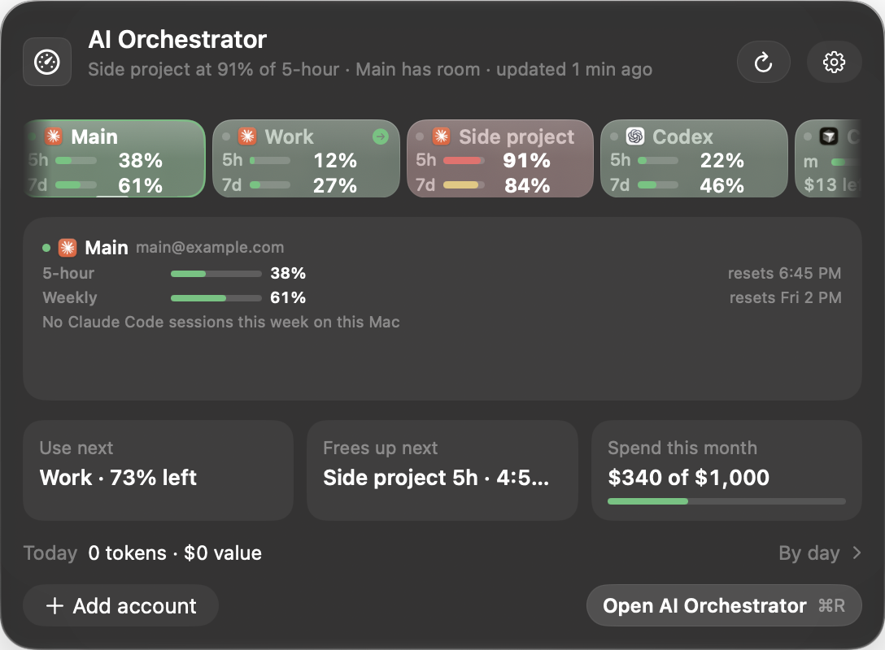
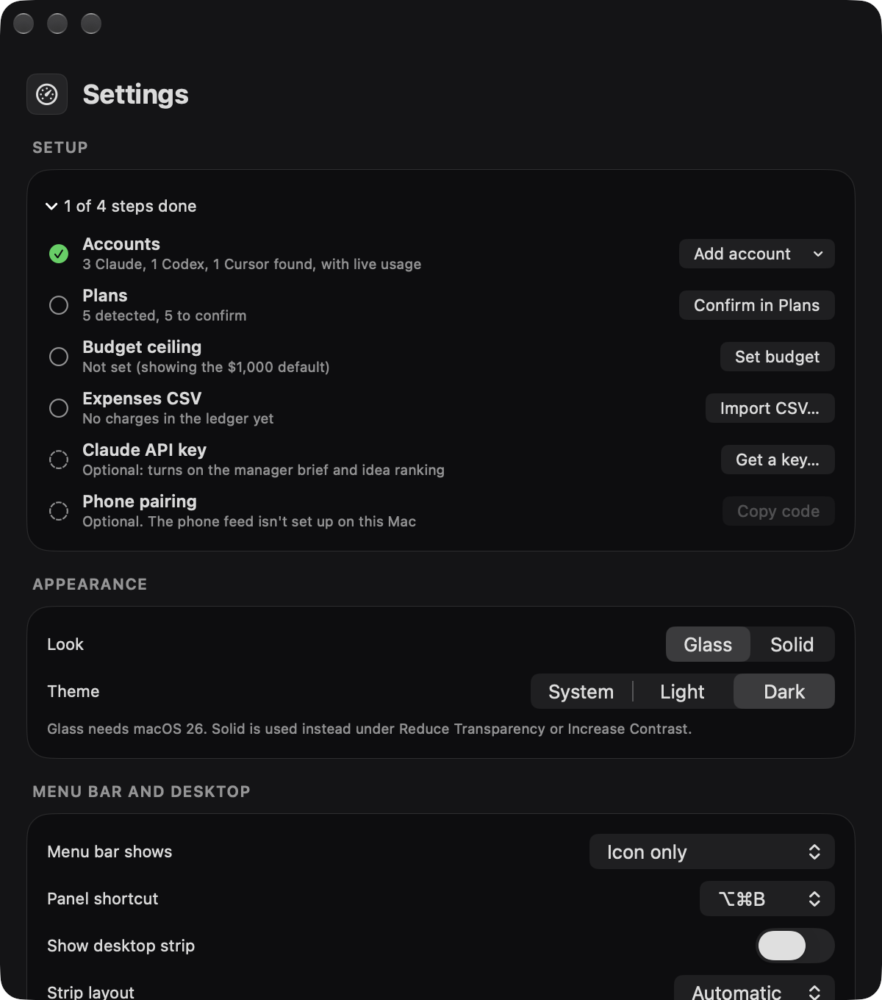

# AI Orchestrator

**See every AI coding plan you pay for in one place, and send work to whichever one has room.**

AI Orchestrator is a free macOS menu-bar app for people who use more than one Claude login, or Claude alongside Codex
and Cursor. It shows each account's 5-hour and weekly limits live, warns you before one runs out, and can route a
coding request to the account with the most room. Everything runs on your Mac with the logins you already have:
no server, no sign-up, no telemetry.



<sub>Screenshots use the built-in demo mode (`scripts/demo.sh`), so every account and number is made up.</sub>

## How it works

1. **It finds your accounts.** It looks for your Claude desktop profiles, Claude Code logins (`~/.claude` and
   `~/.claude-<name>`), Codex and Cursor. You don't need to type in any keys or passwords.
2. **It reads your limits.** For Claude it asks claude.ai for the same usage numbers you see on its Settings › Usage page,
   using your existing signed-in session. For Codex it reads the limit lines Codex writes to its own logs. For Cursor it
   reads your plan usage from cursor.com. It refreshes every few minutes.
3. **It shows them where you work.** You'll see a menu-bar icon and panel, and an optional desktop strip you can drag
   anywhere. Each tile turns amber, then red, as a limit fills up. Click a tile to bring that Claude account's window
   to the front.
4. **It tells you what to use next.** The panel names the account with the most room and the one that frees up next.
   It also notifies you at 90% of a limit, or when an account starts paying for extra usage.
5. **It can do the routing for you (optional).** Write a request, pick a project folder and choose Auto. AI Orchestrator
   plans with one tool, builds with another and reviews with a third. It always picks the account whose limit resets
   soonest, so unused plan time isn't wasted. Each step runs in its own git worktree, risky commands like `git push`
   or `sudo` are blocked, and nothing lands in your branch until you press Merge.


### Also included

- **Spend tracking (optional).** Import a bank or card CSV, or add admin API keys, to see what each AI tool costs you
  per month and per repo against a budget.
- **CLI helpers.** `ai-route` sends a job to the tool with the most room, `idea` adds to a backlog and `orch` opens
  the request window.
- **Handoff kit for Claude Code.** `/handoff` and `/pickup` move work between accounts when one runs low. See below.
- **iPhone companion.** The same usage view on your phone, plus a widget, over your own Wi-Fi.



## Requirements

- macOS 14 (Sonoma) or newer, Apple silicon or Intel
- Xcode Command Line Tools (`xcode-select --install`)
- At least one of these, signed in:
  - [Claude desktop app](https://claude.ai/download) and/or the Claude Code CLI (`claude`)
  - OpenAI Codex CLI (`codex`)
  - Cursor CLI (`cursor-agent`)
- Optional: [T3 Code](https://www.npmjs.com/package/t3) (`npm i -g t3`, then `t3 service install`). The request
  engine uses it when it's running.

## Install (one command)

```bash
curl -fsSL https://raw.githubusercontent.com/waldobi/ai-orchestrator/main/install.sh | bash
```

That clones the repo to `~/ai-orchestrator`, builds the app and opens it. Run it again to update. To also install the
Claude Code handoff kit (see below), add `-s -- --handoff-kit`:

```bash
curl -fsSL https://raw.githubusercontent.com/waldobi/ai-orchestrator/main/install.sh | bash -s -- --handoff-kit
```

If you'd rather read the script first, clone the repo and run `./install.command` yourself.

The installer compiles the six Swift files with `swiftc`, which takes a few minutes. It installs
`~/Applications/AI Orchestrator.app` and opens it. It won't overwrite a different app that already sits at that path.
Set `AIO_APP_PATH` to install somewhere else.

To try it without signing in to anything, run the demo. It uses made-up accounts and a throwaway home folder:

```bash
scripts/demo.sh        # build and run
scripts/demo.sh stop   # quit it
```

For a quick compile check without installing:

```bash
swiftc -parse-as-library -target arm64-apple-macos14.0 -o /tmp/aio AIOrchestrator.swift Orchestrator.swift T3.swift Board.swift Hub.swift OneWindow.swift
```

## Connecting your accounts

AI Orchestrator finds accounts on its own:

| Tool | How it's found |
|---|---|
| Claude (desktop) | Your normal Claude profile, plus any extra Claude profiles you've made. Usage comes from your signed-in session. macOS asks once for "Claude Safe Storage"; click Always Allow. |
| Claude Code CLI | `~/.claude`, plus any `~/.claude-<name>` folder that has a `.claude.json`. Run `CLAUDE_CONFIG_DIR=~/.claude-work claude` once to add a second login. |
| Codex | `~/.codex` and any extra Codex homes you add in Settings. |
| Cursor | `cursor-agent` on your PATH. |

Open **Settings** from the menu-bar icon to rename accounts, hide them, set a monthly budget, or add admin API keys.
OpenAI and Anthropic admin keys are optional and only used for exact API spend. Keys are kept in your login Keychain
under the service `local.ai-orchestrator`. They never go into files.

### Configuration

| Setting | How to change it |
|---|---|
| Extra folders to search for `claude`, `codex`, `cursor-agent` and `t3` | `defaults write local.ai-orchestrator binDirs "$HOME/.npm-global/bin:/some/other/bin"` (or the `AIO_BIN_DIRS` env var) |
| T3 server address | `defaults write local.ai-orchestrator t3Origin http://127.0.0.1:3773` |
| Install location | `AIO_APP_PATH=... ./install.command` |
| Signing identity | `AIO_SIGN_ID="Apple Development: …" ./install.command`. Otherwise it uses the first Apple Development identity, then falls back to ad-hoc. |

## Where data lives

Everything stays on your Mac:

- `~/Library/Application Support/local.ai-orchestrator/`: usage history, token totals, the ledger, requests and `status.json`
- `~/Library/Caches/local.ai-orchestrator/`: parsed transcript cache
- UserDefaults domain `local.ai-orchestrator`: names, layout and preferences
- Keychain service `local.ai-orchestrator`: optional API keys you add

To remove the app, quit it from its menu, then delete the app and those folders.

## Safety

The app and installer never quit, change or delete Claude, Codex or Cursor, their profiles, or your folders. The
request engine refuses `sudo`, `kill`, `pkill`, `killall`, `osascript … quit`, `git push` and keychain dumps inside
agent runs. Every edit happens in a separate worktree until you merge it.

## iPhone companion (optional)

`iPhone/` holds a SwiftUI app and a widget. On the Mac, run the feed:

```bash
bin/phone-feed install   # starts it at login (LaunchAgent local.ai-orchestrator.phone-feed, port 47615, Bonjour)
bin/phone-feed code      # prints the pairing code
```

Then open `iPhone/AIOrchestratorPhone.xcodeproj` in Xcode and set **Signing & Capabilities** for both targets:

1. Pick your own Team.
2. Change the bundle identifiers (`local.ai-orchestrator.phone` and `.phone.widget`) to ones you own.
3. Change the App Group (`group.local.ai-orchestrator.phone`) to match, in both entitlements files and in
   `iPhone/Shared/Feed.swift`.

Run it on your iPhone. It finds the Mac by Bonjour on the same Wi-Fi and asks for the pairing code. To use it away
from home, put both devices on a private network such as Tailscale and enter the Mac's name in the app's settings.

## Handoff kit for Claude Code (optional)

`handoff-kit/` adds three slash commands and two hooks, so work moves cleanly between Claude accounts (or to Codex or
Cursor) when one nears its limit:

- `/handoff` writes `.handoff/<branch>.md` (goal, done, next steps, gotchas) and commits it on the branch.
- `/pickup` finds the newest note, checks it against `git status` and the log, and carries on.
- `/handoff-all` asks every live session on this Mac to write its note, then rebuilds notes from git for any repo
  with unsaved work this week.
- A SessionStart hook shows the branch's note when a session opens. A Stop hook asks for a handoff when the account reaches 90% and again at 97% (set `HANDOFF_AT` to change the first
  one). It reads that usage from the kit's status line.

Install it with `handoff-kit/install.sh`, or use the `--handoff-kit` flag above. It copies the files into
`~/.claude/commands`, `~/.claude/skills` and `~/.handoff-kit`. It adds its hooks to `~/.claude/settings.json` after
backing that file up, and leaves an existing status line alone. For a second Claude login, run it again with
`CLAUDE_CONFIG_DIR=~/.claude-<name>`.

## Project layout

| File | What's in it |
|---|---|
| `AIOrchestrator.swift` | Accounts, usage reading, menu bar, strip, report and settings windows, spend and ledger |
| `Orchestrator.swift` | Request window and plan, build and review steps across tools |
| `T3.swift` | WebSocket client for the local T3 Code server |
| `Hub.swift`, `Board.swift`, `OneWindow.swift` | Router, overview board and the combined window |
| `bin/` | `ai-route`, `idea`, `orch`, `phone-feed` |
| `iPhone/` | Companion app and widget |
| `handoff-kit/` | `/handoff`, `/pickup`, `/handoff-all`, their hooks and installer |
| `install.sh` | One-line installer (clone or update, then `install.command`) |
| `scripts/demo.sh` | Demo mode with made-up data |
| `docs/images/` | Screenshots (demo data) |

## License

MIT. See [LICENSE](LICENSE).
